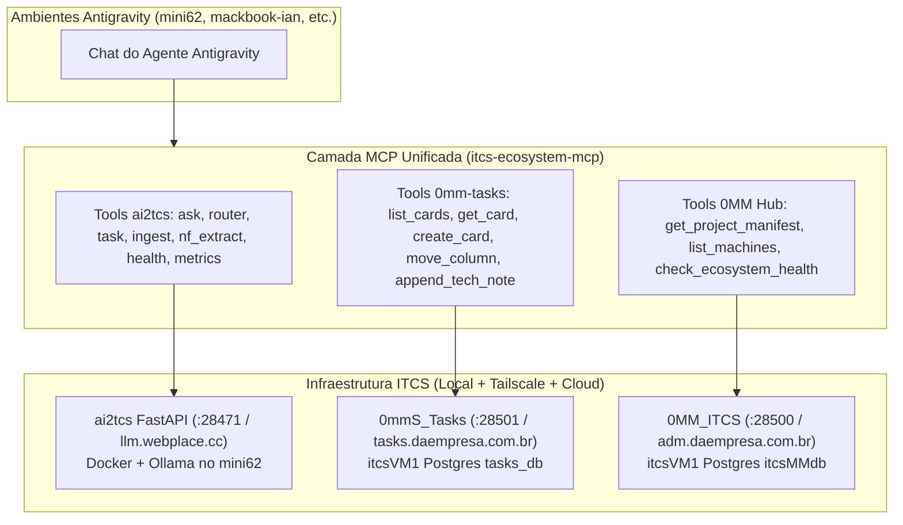
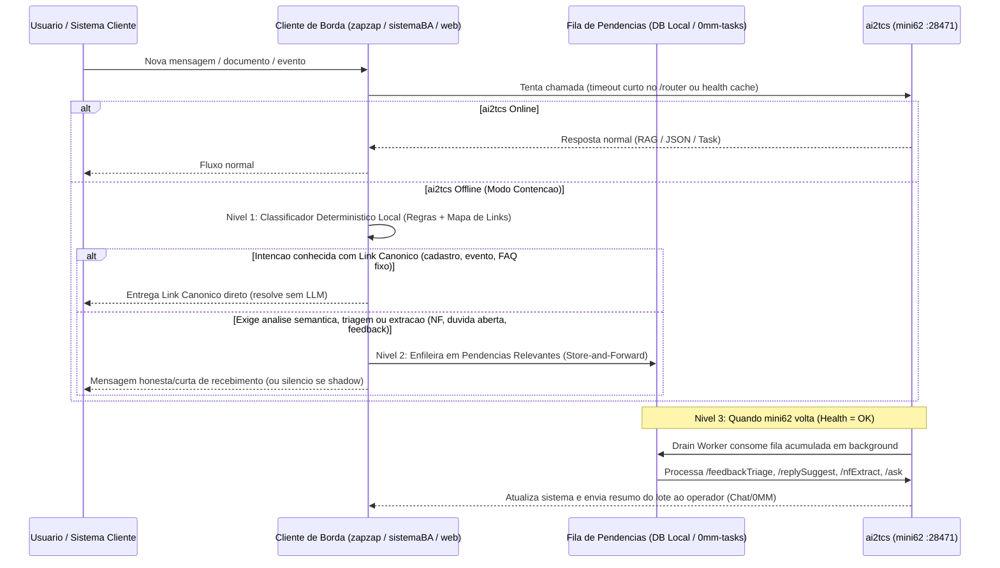
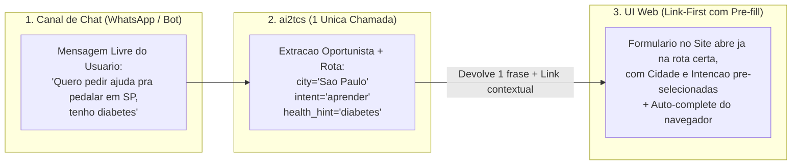

# Avaliacao de Arquitetura, Ecossistema ITCS (0MM + Tasks + ai2tcs) e Plano de Evolucao

**Data:** 2026-11-09
**Escopo:** Revisao arquitetural do repositorio `ai2tcs` em conjunto com o ecossistema `0MM_ITCS` e `0mmS_Tasks`, desenho de integracao via MCP para ambientes Antigravity, estrategia de autonomia/fallback offline e arquitetura hibrida Chat vs. UI (Link-First).
**Natureza:** Documento de revisao e desenho arquitetural (nenhum codigo ou container de producao foi alterado).

---

## 1. Avaliacao Geral do Projeto `ai2tcs`

O `ai2tcs` nao e apenas um wrapper sobre o Ollama: e uma plataforma de inferencia local multi-projeto desenhada com disciplina operacional de producao. A leitura do codigo em `llm_api/app/` e da documentacao (`docs/01` a `docs/20` e `10d_ai2tcs_contrato_e_evolucao.md`) evidencia decisoes maduras que evitam os erros mais comuns em projetos de IA aplicada.

### 1.1 Pontos Fortes Consolidados

- [ x ] **Topologia Hibrida de Custo Marginal Zero (`mini62` + Docker + Ollama Host + Tailscale/Cloudflare):**
  Rodar FastAPI e PostgreSQL em containers (`llm_api/docker-compose.yml`) comunicando com o Ollama nativo no macOS via `host.docker.internal:11434` aproveita a memoria unificada (UMA/Metal) do Apple Silicon sem overhead de virtualizacao na GPU, expondo a porta `28471` de forma segura na tailnet e em `https://llm.webplace.cc`.
- [ x ] **Separacao Estrita entre Autoridade e Inferencia:**
  A regra canonica documentada no contrato do Bike Anjo (`10d_ai2tcs_contrato_e_evolucao.md` §1.2, §1.3 e §5) — onde a LLM nunca executa acoes mutaveis por conta propria, nunca recebe credenciais/niveis de autorizacao (`clearance` NOIA) no prompt e nunca recebe IDs internos nao-compartilhaveis (`journey_destination` so entra se ja for URL absoluta) — protege o sistema contra prompt injection e vazamento de estado interno.
- [ x ] **Silencio como Resposta Valida (`no_answer` de 1a Classe):**
  Tratar `no_answer` como sucesso operacional (preferir silencio a alucinacao), combinado com guards deterministas (`app/rag/answer_guard.py`, `policies.forbidden_terms`, `_sanitize_answer` e bloqueio pre-LLM de casos graves em `/replySuggest`), garante confiabilidade em canais reais como WhatsApp.
- [ x ] **Motor Generico de Tarefas de Texto (`POST /task/{task_id}`):**
  A introducao de `llm_api/app/tasks/` (`docs/20-text-tasks.md`) transforma classificacao, triagem e extracao estruturada em configuracao declarativa (`llm_api/tasks/<task_id>.json` + prompt em arquivo + vocabulario fechado em `config_json.tasks` de cada projeto). Isso permite que qualquer projeto do ecossistema ganhe capacidades analiticas sem novas rotas hardcoded.
- [ x ] **Observabilidade Deterministica e Portao de Avaliacao (`eval_gate.py` + `signals` + `__metrics`):**
  O registro centralizado de tokens e latencia (`llm_call`, `heavy`, `near_ctx_limit`), a substituicao da confianca puramente opinativa da LLM por sinais objetivos (`best_distance`, `chunks_kept`, `guard_hit`, `sanitize_hit`) e o swap atomico via collection `__staging` no ChromaDB durante o ingest demonstram engenharia focada em estabilidade.

### 1.2 Pontos de Atencao Tecnicos no Codigo Atual (Sugestoes Diretas)

1. **Colisao de Deduplicacao no `/ask` entre Contatos Diferentes (`llm_api/app/api/ask.py`):**
   - **Diagnostico:** O hash de deduplicacao (janela de 600s) usa apenas `f"{project_id}:{normalized_question}"`. Como agora o `/ask` injeta contexto rico do usuario (cidade, interesse, jornada, proximo evento) no prompt, dois contatos de cidades diferentes fazendo a mesma pergunta ("Tem oficina na minha cidade?") dentro de 10 minutos recebem o mesmo `job_id` e a resposta personalizada do primeiro contato.
   - **Recomendacao:** Incluir na semente do `_question_hash` o `user_id` (quando presente) ou um hash canonico das chaves de contexto que alteram a resposta (`city`, `state`, `journey_kind`, `interesse`). Assim o dedup continua absorvendo rajadas do mesmo contato sem misturar respostas entre pessoas distintas.
2. **Alinhamento entre `user_id` e `id_contato` (`llm_api/app/api/ask.py` e `app/models.py`):**
   - **Diagnostico:** `AskRequest` declara `user_id`, mas nao declara `id_contato` (que cai em `extra="ignore"`), tornando `hasattr(request, "id_contato")` sempre falso.
   - **Recomendacao:** Declarar `id_contato: str | None = None` como alias opcional em `AskRequest` (ou normalizar num model validator para popular `user_id`), garantindo que qualquer cliente que envie um dos dois nomes ative corretamente o historico/perfil quando desejado.
3. **Divergencia de Contrato no Rerank de Diversidade (`llm_api/app/jobs/worker.py`):**
   - **Diagnostico:** `_rerank_for_diversity` move os chunks excedentes de um mesmo documento para o final da lista (`selected + deferred`), mas nao corta o total enviado ao prompt.
   - **Recomendacao:** Adicionar uma chave opcional em `config_json.policies` (`max_chunks_per_doc_strict: bool` ou `max_total_chunks_in_prompt: int`) para cortar os excedentes apenas nos projetos validados pelo `eval_gate.py`, reduzindo consumo de contexto (`prompt_tokens`).
4. **Sonda de Saude (`/health`) vs. Monitoramento do Hub `0MM_ITCS`:**
   - **Diagnostico:** `GET /health` faz verificacao real de Ollama, Postgres e disco (`status: "ok" | "degraded"`), mas `itcsManifest.yaml` aponta o check para `/` esperando apenas HTTP 200.
   - **Recomendacao:** Apontar `monitor.checks` no `itcsManifest.yaml` para `/health` (e opcionalmente adicionar `GET /health?strict=1` que devolve HTTP 503 quando `status == "degraded"`), permitindo que o `0MM_ITCS` detecte imediatamente quando o Ollama local parar mesmo com o container FastAPI de pe.

---

## 2. Visao de Ecossistema (`0MM_ITCS` + `0mmS_Tasks` + `ai2tcs`) e MCP para Antigravity

A leitura cruzada deste repositorio com `/Users/ianthomaz/Documents/projects/0MM_ITCS` (`docs/08_ecosystem_integration.md`, `docs/09_tasks_service.md`, `docs/10_tasks_data_model.md` e `docs/12_integration_map.md`) revela algo fundamental: voce construiu uma **arquitetura de orquestracao multi-maquina e multi-projeto completa antes de os agentes comerciais existirem com esse conceito**.

Hoje o seu ecossistema ja possui tres pilares claramente separados:

| Pilar | Repositorio / Servico | Porta / Host | Papel na Arquitetura |
|---|---|---|---|
| **1. Governanca e Catalogo** | `0MM_ITCS` | `:28500` (`adm.daempresa.com.br` / `itcsVM1`) | Verdade sobre projetos (`project_db_id`), maquinas (`mini62`, `itcsVM1`, `linodeBA2026`, `pcVelho`), dominios, manifestos, skills (`sync-to-blackair.sh`) e saude |
| **2. Estado Operacional e Backlog** | `0mmS_Tasks` (`0mm-tasks`) | `:28501` (`tasks.daempresa.com.br` / `itcsVM1`) | Quadro Kanban central por `project_db_id` (`boards`, `cards`, `SECTORS` fixos, `parent_id`, `merged_into_id`, ator delegado `x-actor-id`), discovery `/api/welcome` e lote `/api/ops/observe/tasks` |
| **3. Cognicao, RAG e Extracao** | `ai2tcs` | `:28471` (`llm.webplace.cc` / `mini62`) | Motor compartilhado de LLM local (Ollama), RAG por `project_id`, tarefas declarativas (`/task/{task_id}`), NF/Boleto, STT e EDU |

> **Nota sobre o `sync-to-blackair.sh` (`0MM_ITCS/agent/sync-to-blackair.sh`):**
> Hoje esse script ja cria symlinks das skills canonicas (`0MM_ITCS/.claude/skills/*`) para `~/.cursor/skills/` e `~/.claude/skills/` no `mini62` e sincroniza via `rsync` para o `blackair`. Basta adicionar 2 linhas nesse mesmo script apontando tambem para `~/.gemini/config/skills/` (e `~/.gemini/config/mcp_config.json`) para que todo o seu ambiente Antigravity em todas as maquinas herde automaticamente o `getAware`, as skills do `0MM` e o MCP do ecossistema.

### 2.1 Por que um MCP Unificado (`itcs-ecosystem-mcp`) e Superior a um MCP Isolado

Em vez de expor apenas o `ai2tcs` para o Antigravity, o verdadeiro salto de produtividade e um **MCP do Ecossistema ITCS** que conecte os tres pilares simultaneamente em qualquer sessao do Antigravity (esteja voce no `mini62`, no `mackbook-ian` ou em outra maquina).

Com isso, de dentro de qualquer chat do Antigravity voce pode pedir:
- *"Liste os cards `em_desenvolvimento` do projeto `bikeanjoall_2026` no `0mm-tasks`, rode um teste ao vivo no `/router` e no `/ask` do `ai2tcs` para validar a mudanca e anote o resultado no `tech_note` do card."*
- *"Consulte no `0MM` quais projetos consomem a LLM, cheque o `/health` e as chamadas `llm_heavy` das ultimas 24h no `ai2tcs`."*
- *"Use a LLM local (`ai2tcs`) para classificar este lote de textos via `/task/text_triage` sem gastar tokens externos."*

### 2.2 Comparativo das Duas Alternativas de Implementacao do MCP (Para Decisao)

Voce comentou que gostou das duas opcoes de transporte para o MCP, mas queria elementos claros para decidir. Abaixo esta a comparacao pratica entre elas no seu cenario:

| Criterio | Alternativa A: MCP Local via `stdio` (Script Python no `~/.gemini/config/mcp_config.json`) | Alternativa B: MCP Remoto via `Streamable HTTP` (Endpoint `/mcp` exposto pelo `mini62` / Cloudflare) |
|---|---|---|
| **Como funciona** | O Antigravity inicia um pequeno processo Python local quando abre o chat; esse script faz chamadas HTTP (`httpx`) para `localhost:28471` (se estiver no `mini62`) ou `https://llm.webplace.cc` / `https://tasks.daempresa.com.br` | O `mini62` roda um servidor MCP HTTP (ex.: porta `:28474` ou rota `/mcp`) atras de Tailscale/Cloudflare; o Antigravity conecta direto pela URL |
| **Impacto no container atual do `ai2tcs`** | **Zero.** Nao toca no Docker nem no FastAPI em producao | Baixo se feito como container/processo sidecar (como o `:28472`); medio se embutido dentro do proprio FastAPI `:28471` |
| **Acesso a arquivos locais da maquina onde voce esta** | **Sim.** Pode enviar um PDF local do `mackbook-ian` direto para `/nfExtract` ou ler credenciais locais em `_credentials/` | Nao enxerga o disco do `mackbook-ian` (so enxerga o disco do `mini62`) |
| **Configuracao em outra maquina (`mackbook-ian`)** | Precisa ter o script Python sincronizado (ex.: via repo `ITCS` / `0MM_ITCS` que voce ja sincroniza com `getAware.sh`) | Zero arquivo local: basta colocar a URL e o header de auth no `mcp_config.json` |
| **Seguranca de Rede** | Usa exatamente os tokens Bearer existentes (`LLM_API_TOKEN`, `TASKS_API_TOKEN`) sem abrir nova superficie HTTP publica | Exige proteger o endpoint `/mcp` no Cloudflare/Nginx com Bearer token para nao expor ferramentas na internet |

**Recomendacao Pratica:**
Comecar pela **Alternativa A (`stdio` empacotado como Plugin/MCP no seu repo de configuracao ou dentro de `ai2tcs/mcp/`)**.
Motivo: voce ja tem o habito e os scripts de sincronizar configuracoes entre maquinas (`getAware.sh` / `sync-to-blackair.sh`), a Alternativa A **nao encosta no container de producao do `ai2tcs`**, permite enviar arquivos locais para `/nfExtract` ou `/boletoExtract`, e funciona tanto apontando para `127.0.0.1:28471` (quando voce esta no `mini62`) quanto para o IP Tailscale ou `https://llm.webplace.cc` (quando voce esta remoto).

---

## 3. Autonomia, Inteligencia (Bike Anjo / Chinese Learning) e Fallback Offline

A sua diretriz para o fallback offline e cirurgica: **o fallback jamais deve tentar ser uma copia da LLM principal em outro provedor pago**, mas sim um mecanismo para **segurar a onda com dignidade e organizar uma fila de pendencias relevantes** ate que o `ai2tcs` no `mini62` volte a ficar online.

### 3.1 Arquitetura de Fallback Offline: "Segurar a Onda + Fila de Pendencias (Store-and-Forward)"

Quando o `mini62` fica offline (queda de energia, reboot, manutencao do Docker/Ollama) ou quando o `/health` acusa `ollama: unreachable`, os sistemas clientes (`zapzap`, `sistemaBA`, `chineseLearning`) devem operar em **Tres Niveis de Degradacao Consciente**:

#### Nivel 1 — "Segurar a Onda" no Cliente (Regras Deterministicas + Banco Local)
- **No Bike Anjo / `zapzap`:**
  O `message-intent.js` ja filtra saudacoes e emojis antes da LLM. Se o `ai2tcs` estiver offline, um segundo estagio deterministico (baseado em palavras-chave de alta precisao para as 5 demandas principais: *quero aprender*, *quero ser voluntario*, *proximo evento*, *cadastro*, *problema com conta*) entrega diretamente o link canonico da plataforma. Como a filosofia do Bike Anjo ja e **link-first**, 60% a 70% das demandas comuns sao atendidas com uma frase fixa + link oficial sem que o usuario sinta que a IA caiu.
- **No `chineseLearning` (`/edu/*`):**
  O banco PostgreSQL ja guarda o vocabulario (`edu/vocabulary`), os pontos gramaticais (`edu/grammar`) e o progresso por aluno (`edu/progress`). Se o Ollama estiver indisponivel:
  - `POST /edu/exercise` pode gerar exercicios `fill_blank` e `translation` **100% de forma deterministica via SQL** sorteando palavras que o aluno ainda nao dominou (`mastered = false`), usando os distratores do mesmo nivel HSK!
  - `POST /edu/chat` pode devolver uma resposta estruturada (`reply_structured`) convidando o aluno para um modo de revisao rapida de flashcards do nivel dele enquanto o tutor conversacional recarrega. O aluno continua estudando sem tela de erro.

#### Nivel 2 — Fila de Pendencias Relevantes (Store-and-Forward durante Offline)
O que realmente precisa de inteligencia (uma duvida especifica no WhatsApp, um relato de oficina para `/feedbackTriage`, um chamado para `/replySuggest`, um PDF para `/nfExtract` ou um texto para `/task/text_triage`) **nao deve falhar e sumir**:
- **Tabela `deferred_llm_jobs` (no cliente/VM) ou integracao direta com `0mmS_Tasks`:**
  - Quando o cliente recebe `ConnectionRefused` / `502` / `504` ou `status: degraded` do `ai2tcs`, ele grava o payload num buffer persistente com classificacao de relevancia:
    - **Descartavel (Nao enfileirar):** mensagens ja resolvidas pelo link deterministico do Nivel 1, pings ou conversas efemeras.
    - **Relevante (Enfileirar para processamento assincrono):**
      1. Chamados de suporte e duvidas sem match deterministico (para gerar `/replySuggest` ou resposta diferida).
      2. Submissoes de formularios (`feedbackTriage`, `healthNormalize`, `text_triage`).
      3. Documentos fiscais/boletos enviados fora do ar (`nfExtract`, `boletoExtract`).

#### Nivel 3 — Reconciliacao Automatica na Volta (`Drain & Digest`)
- Quando o `mini62` volta a ficar online, o `ai2tcs` (ou o worker do cliente) drena a fila com controle de concorrencia (para nao afogar o Ollama no boot).
- Ao terminar de drenar a fila acumulada, o sistema dispara **uma unica notificacao consolidada** via contrato do `0MM` (`/notify` no Google Chat) ou cria/atualiza cards no `0mmS_Tasks`:
  *"ai2tcs voltou online. 14 pendencias acumuladas na janela offline foram processadas: 2 chamados urgentes triados, 9 feedbacks classificados, 3 rascunhos de resposta prontos para revisao."*

---

### 3.2 Como Tornar o `ai2tcs` Mais Inteligente e Autonomo Quando Online

Para elevar a qualidade das respostas no **Bike Anjo** e no **Chinese Learning** mantendo execucao local no `mini62`:

1. **Ciclo Fechado Shadow -> Few-Shot Dinamico no Chroma (Bike Anjo):**
   - Hoje os julgamentos humanos no painel shadow (`great` vs `bad`) servem para avaliacao (`eval_gate.py`).
   - **Proximo passo de inteligencia:** criar uma collection separada por projeto (`data/<project_id>/approved_examples`) alimentada automaticamente pelas respostas avaliadas como `great`.
   - Quando uma pergunta nova chegar no `/router` ou no `/ask`, alem de buscar os 5 trechos da `bibliotecaConteudoLLM`, o `retrieve.py` busca os **2 exemplos reais ja aprovados pelo humano** mais parecidos com a pergunta atual e os injeta como few-shot no prompt. O modelo local (`gemma3:12b`) melhora drasticamente o tom, o tamanho da resposta e a escolha do link quando ve 2 exemplos reais aprovados do proprio projeto.
2. **Roteamento Guiado por Sinais (`signals`) em vez de Autoconfianca Cega (Bike Anjo):**
   - Usar o bloco deterministico `signals` (implementado na revisao 19: `best_distance`, `chunks_kept`, `guard_hit`) diretamente na regra do `/router`: se `best_distance` for ruim (acima do limiar calibrado na tabela confianca x nota), rebaixar automaticamente um `answer_now` do modelo `fast` para `escalate` (ou `no_answer`), impedindo que o modelo pequeno responda com confianca alta quando o RAG nao trouxe base solida.
3. **Tutoria Adaptativa Guiada pelo Banco de Erros (`chineseLearning` / `/edu/*`):**
   - Hoje o `POST /edu/chat` sabe o `level` (`HSK1`, `HSK2`), mas nao consulta o historico de acertos/erros do `user_id` na tabela de progresso.
   - **Melhoria de alto impacto e baixo custo:** antes de montar o system prompt do `/edu/chat`, fazer um `SELECT` simples nas 5 palavras do nivel do aluno onde `seen_count > 0` e a taxa de acerto e mais baixa (ou palavras aprendidas ha mais dias), e injetar no prompt do tutor:
     *"Palavras prioritarias para praticar naturalmente nesta conversa com este aluno: [汉字1, 汉字2, ...]."*
   - Isso transforma o chat livre num sistema de repeticao espacada (SRS) invisivel, sem exigir um modelo maior.

---

## 4. Arquitetura de Produto: Chat vs. Telas UI ("Link-First + Pre-fill" vs. Conversational Form)

A sua reflexao sobre ter voltado o onboarding do chat para um link de site toca num dos pontos mais importantes (e menos discutidos) de engenharia de produto com IA:

> **Fingir que um chat e um formulario longo e caro em computacao, fragil em validacao e pior em UX do que um formulario web moderno com auto-complete do navegador.**

### 4.1 Por que Formularios Complexos em Chat Falham (e Custam Caro)

1. **Atrito Cognitivo e Perda do Auto-Complete Nativo:**
   No navegador (iOS/Android/Desktop), preencher Nome, E-mail, Telefone, CEP e Endereco leva 2 toques gracas ao autofill do sistema operacional, mascaras visuais de input e seletores nativos de data. No chat, a pessoa precisa digitar campo por campo, se corrigir quando erra um digito, e ler blocos de texto entre cada pergunta.
2. **Explosao de Regras de Estado e Consumo de LLM:**
   Um formulario de 8 campos com regras condicionais no chat exige manter maquina de estados de sessao, tratar desvios ("espera, mudei de ideia sobre o dia", "meu CEP nao sei de cabeca"), validar formato a cada turno e reenviar o historico inteiro para a LLM a cada mensagem. Voce gasta 8x mais chamadas de inferencia para fazer o que um `<form>` HTML faz de graca no cliente.

### 4.2 O Padrao Hibrido Ideal: "Chat como Triador e Pre-enchedor + Web para Coleta Densa"

Voce nao precisa escolher entre os extremos ("tudo em chat burocratico" vs. "link estatico cego"). A combinacao mais inteligente — que aproveita o seu conceito de **POfR (Point of Return)** e reduz custos — divide a responsabilidade em tres camadas:

#### Regra de Ouro: Matriz de Decisao (Quando usar Chat vs. Quando entregar Link UI)

| Tipo de Interacao | Onde Resolver | Como a `ai2tcs` Participa | Por que funciona melhor |
|---|---|---|---|
| **Onboarding / Cadastro / Inscricao (> 2 campos estruturados, termos de uso, CEP, CPF, data)** | **Tela UI Web (Link-First)** | `POST /router` identifica a intencao em **1 turno**, extrai qualquer dado que a pessoa ja tenha falado espontaneamente e devolve o link direto da tela certa | Usa auto-complete do navegador, validacao HTML/JS a custo zero de LLM e evita interrogatorio no chat |
| **Micro-transacoes de 1 Turno (Confirmar presenca, cancelar, dar nota rapida, responder sim/nao)** | **Direto no Chat** | Regra deterministica no bot (`reply-reader.js`) + fallback em `POST /extract` (`reply_intent`) apenas quando a frase for ambigua | Zero friccao para o usuario (nao precisa abrir navegador so para dizer "Eu vou") |
| **Entrada Nao-Estruturada / Midia (Mandar PDF/foto de Nota Fiscal, Boleto, audio de relato ou link de artigo)** | **Direto no Chat (ou Upload simples)** | `POST /nfExtract`, `POST /boletoExtract`, `POST /audio/transcribe`, `POST /task/text_triage` | A LLM faz o trabalho pesado de transformar arquivo/texto livre em JSON estruturado, e devolve um link ou resumo apenas para o humano aprovar |
| **Duvida Aberta / Consulta de Regras ou Status** | **Chat + Link de Acao (POfR)** | `POST /ask` ou `POST /router` responde em 1 frase objetiva com base no RAG e cola o link exato onde a pessoa executa a acao | Informa sem inventar e empurra a execucao transacional para a interface web segura |

### 4.3 Evolucao do "Link-First": Deep-Link com Pre-Preenchimento Oportunista (Zero-Turn Pre-fill)

Para deixar a experiencia de "chat entrega o link e voce termina no site" ainda mais fluida sem adicionar perguntas no chat:
1. O chat **nunca** pergunta campos que o formulario do site ja coleta.
2. Porem, se na primeira mensagem o usuario **ja escreveu espontaneamente** informacoes uteis (ex.: *"Oi, sou o Marcos de Curitiba e quero ajudar como voluntario"*), o `/router` pode devolver um objeto opcional `extracted_prefill: {"city": "Curitiba", "intent": "voluntario"}`.
3. O backend do cliente gera o link com esses parametros (ou grava no estado do POfR daquele contato). Quando o usuario toca no link do WhatsApp, a pagina web ja abre com *"Curitiba"* e *"Quero ser voluntario"* selecionados, restando apenas confirmar os dados com o auto-complete do navegador.
4. **Resultado:** custo de apenas **1 chamada curta** na LLM local, zero conversa burocratica no WhatsApp e conversao maxima no site.

---

## 5. Resumo do Roadmap Sugerido (Em Ordem de Retorno sobre Esforco)

- [ ] **Passo 1 (Saneamento Rapido no `ai2tcs`):** Ajustar o hash de deduplicacao do `/ask` para considerar contexto/usuario (`1.2.1`) e apontar o check do `itcsManifest.yaml` para `/health`.
- [ ] **Passo 2 (Ponte Antigravity <-> Ecossistema ITCS):** Criar o servidor MCP local (`stdio`) unificando `ai2tcs` (`:28471`), `0mmS_Tasks` (`:28501`) e `0MM_ITCS` (`:28500`), permitindo operar tarefas, consultar RAG e rodar inferencias locais direto deste chat.
- [ ] **Passo 3 (Resiliencia Offline "Segurar a Onda + Fila"):**
  - Implementar fallback deterministico SQL nos exercicios do `/edu/exercise` quando o Ollama estiver indisponivel.
  - Implementar a fila `deferred_llm_jobs` nos clientes (`zapzap`/`sistemaBA`) para reter triagens, NF e duvidas abertas quando o `mini62` estiver offline, drenando automaticamente na volta com aviso no Google Chat / `0MM`.
- [ ] **Passo 4 (Mais Inteligencia com o Mesmo Hardware):**
  - Indexar exemplos `great` do shadow numa collection de few-shot dinamico por projeto no ChromaDB.
  - Injetar as palavras com maior taxa de erro do aluno (`edu/progress`) no system prompt do `/edu/chat`.
