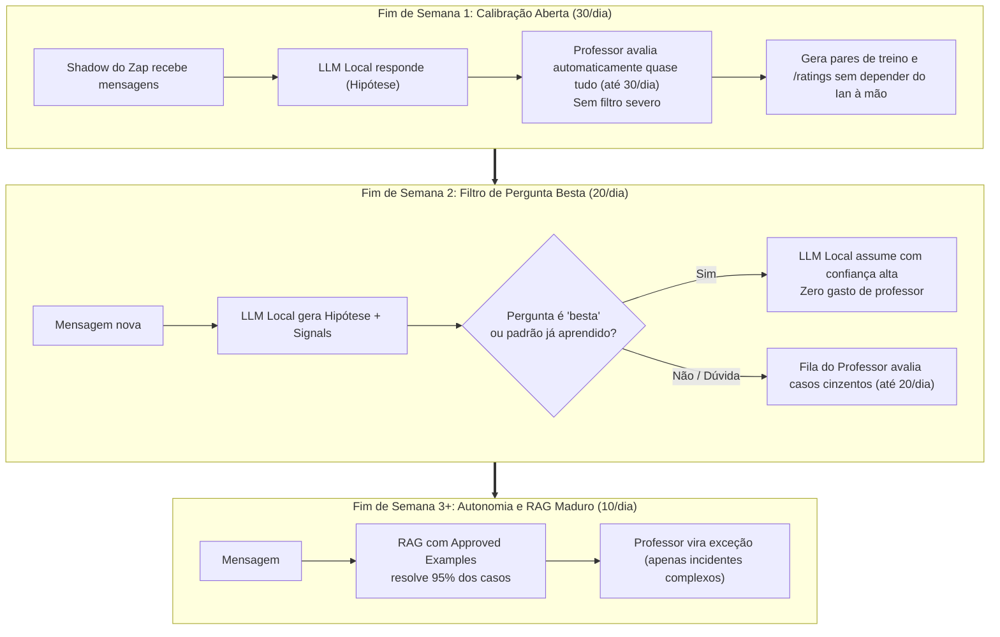
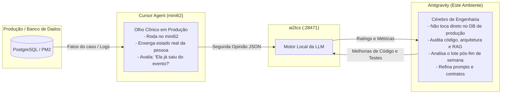

# Plano Operacional por Fases: Finais de Semana de Treino, Cotas e Papéis (Cursor vs Antigravity)

**Data:** 2026-11-12  
**Contexto:** Preparação para os finais de semana de alto tráfego no Bike Anjo (e outros projetos), calibração da LLM local via segunda opinião automática, e definição clara dos papéis entre **Cursor** (inspeção de produção/banco) e **Antigravity** (auditoria, código e arquitetura).

---

## 1. O Funil de Evolução: Como o Sistema Aprende nos Fins de Semana

O objetivo é que, ao longo de 2 a 3 finais de semana, a LLM local (`ai2tcs`) passe de "muito assistida" para **confiante e autônoma**, deixando de incomodar o professor para perguntas simples ou resolvidas.

---

## 2. A Régua de Cotas Dinâmicas (Controlada por Configuração)

Em vez de um número estático no código, o limite diário vive em configuração rápida no `.env` ou no painel:

| Fase / Momento | Cota Sugerida | Critério de Entrada no Professor | Objetivo Principal |
|---|---|---|---|
| **Fim de Semana 1 (Aberto)** | **30 consultas/dia** | Quase tudo que cai no shadow e tem baixa/média confiança ou sinal de ação | Acumular volume de avaliações e exemplos sem você precisar rotular manualmente depois. |
| **Pós-Fim de Semana 1 (Ajuste)** | **20 consultas/dia** | Barrar "perguntas bestas" (saudação, link padrão, ruído) | Reduzir custos focando onde a LLM local realmente erra a intenção. |
| **Regime de Cruzeiro** | **10 consultas/dia** | Apenas conflitos reais (ex: texto diz liberar, mas botão não foi usado) | Manter apenas a supervisão fina dos casos de borda. |

> **Mecanismo de Controle em Tempo Real:**  
> Se no meio do sábado você perceber pelo painel que o volume está alto ou o saldo de créditos está caindo rápido, basta alterar `SECOND_OPINION_DAILY_LIMIT=15` (ou criar o arquivo `local-only/DISABLE_SECOND_OPINION`) que a fila corta instantaneamente sem reiniciar os serviços.

---

## 3. Divisão de Papéis: Cursor vs. Antigravity

Você tocou num ponto essencial de arquitetura: **quem olha o quê e por onde cada um atua.**

### O Papel do Cursor Agent (O Inspetor de Campo no `mini62`):
- **Onde ele brilha:** Ele está instalado direto no macOS do `mini62` (`cursor-agent`). Ele tem acesso seguro e local às ferramentas de inspeção.
- **O que ele faz na segunda opinião:** Ele recebe o pacote, pode consultar os fatos do caso (ou checar o estado da inscrição) e cravar: *"A Larissa já não está mais no evento porque o botão de liberação foi registrado há 1 minuto. A resposta local está errada."*
- **Saída:** Devolve o JSON estrito conforme o `contrato-segunda-opiniao.md`.

### O Papel do Antigravity (O Engenheiro / Arquiteto):
- **Onde ele brilha:** Visão ampla de repositório, consistência de documentação, refatoração segura de código e suítes de teste.
- **O que ele faz:**
  1. Analisa as métricas agregadas da semana (`/metrics`, `test_eval_gate`, relatórios de erro).
  2. Pega os casos onde o Cursor deu nota `bad` e investiga: *"Por que o RAG local errou? Foi o chunking? Foi o prompt? Faltou hint no corpus?"*
  3. Atualiza o código local, roda os 443 testes e garante que a LLM local suba de nível para o próximo fim de semana.

---

## 4. O Filtro da "Pergunta Besta": Como a LLM Aprende a Não Chamar o Professor

Como você mencionou, não queremos gastar consultas com perguntas óbvias. A chave para a LLM filtrar o que é "besta" são os **sinais determinísticos (`signals`)**:

1. **Quando NÃO chamar o professor (Pergunta Besta / Padrão):**
   - **Bucket C (Ruído):** "Oi", "Obrigado", emojis $\rightarrow$ Rota direta de silêncio ou saudação padrão.
   - **Bucket D (Link Direto):** "Onde me cadastro?", "Qual o site?" $\rightarrow$ Rota direta `cadastro` com link canônico.
   - **Bucket A com Alta Confiança Real:** Pergunta factual institucional onde a distância do melhor chunk do Chroma foi excelente (`best_distance < 0.25`), sem termos proibidos e sem sinais de conflito.
2. **Quando CHAMAR o professor (Casos Críticos):**
   - Mensagens recebidas em campanhas de confirmação de presença.
   - Textos contendo verbos de ação mútua (*"liberar"*, *"desistir"*, *"cancelar"*, *"confirmar"*).
   - Casos onde a LLM local deu confiança autodeclarada alta, mas a distância de RAG foi ruim (`best_distance > 0.45` — sinal clássico de que ela está "chutando" com convicção).

---

## 5. Próximos Passos para o Fim de Semana

1. **Configurar a Cota Inicial de 30:** No `.env` ou nas variáveis da fila, definir `SECOND_OPINION_DAILY_LIMIT=30`.
2. **Deixar o Shadow Coletar:** No primeiro fim de semana com a rotina ativa, deixar o Cursor gerar as avaliações no `mini62`.
3. **Revisão Pós-Fim de Semana (Na Segunda-Feira):**
   - Abrimos aqui no Antigravity o lote de avaliações geradas.
   - Vemos onde o Cursor e a LLM local discordaram.
   - Os pares corrigidos entram como exemplos aprovados para a LLM local.
   - Na semana seguinte, baixamos a cota para 20 e ativamos o filtro de perguntas bestas.
