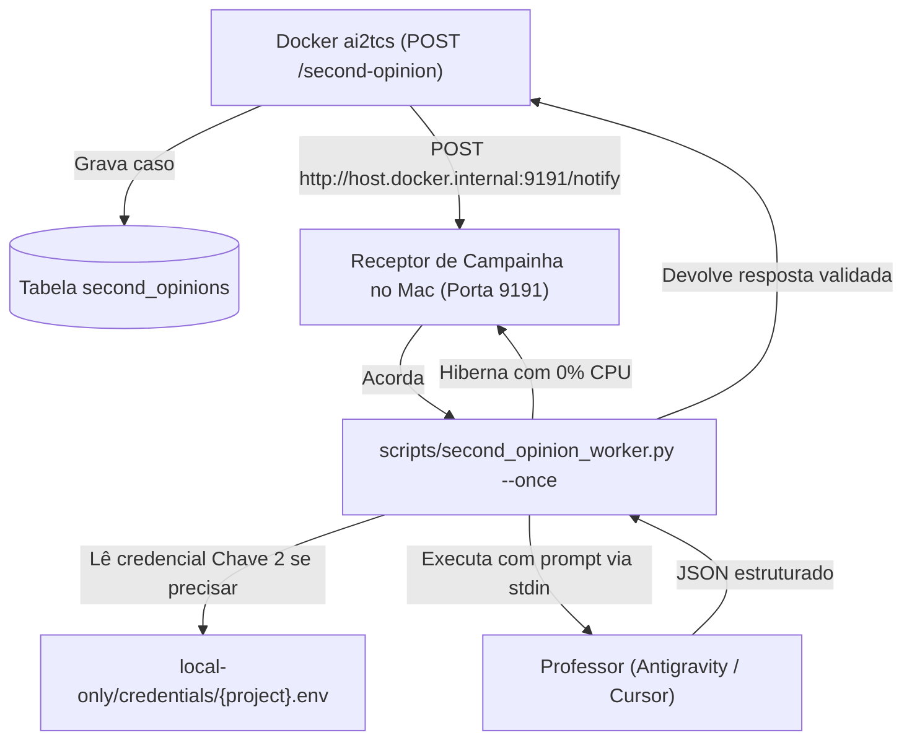

# Guia de Implementação e Isolamento Operacional no mini62

Este documento estabelece as **travas estruturais**, o **wrapper de execução** e a **arquitetura de contingência de recursos** para que agentes maiores (`Cursor Agent` e `Antigravity`) atuem como professores sem colocar em risco o `mini62` nem consumir créditos de forma descontrolada.

---

## 1. Travas e Limites Estruturais de Execução

| Camada | Regra de Isolamento | Mecanismo de Garantia no mini62 |
|---|---|---|
| **1. Permissão de Sistema (OS)** | Usuário sem chave de deploy, sem acesso a `.env` com tokens de produção e sem acesso à Meta Cloud API | Execução sob usuário isolado e credenciais restritas em `local-only/credentials/` |
| **2. Somente Leitura (Zero Mutação)** | O agente professor nunca executa SQL livre, nunca comita código e nunca dispara HTTP mutável | O pacote de entrada já contém os fatos pré-computados (`case_facts`); se precisar auditar produção, usa estritamente a chave somente-leitura |
| **3. Cota Diária e Budget** | Teto rígido de consultas para não estourar créditos do plano | Contador diário no banco de dados (`SECOND_OPINION_DAILY_LIMIT`); padrão: **20 consultas/dia** |
| **4. Timeout e Process Kill** | Impedir que chamadas penduradas prendam a CPU/RAM do Mac mini | Timeout estrito de **45 segundos** gerenciado pelo `second_opinion_worker.py` no host |
| **5. Kill Switch Imediato** | Desligar a fila instantaneamente sem necessidade de redeploy | Flag booleana no banco/config ou existência do arquivo `local-only/DISABLE_SECOND_OPINION` |
| **6. Não-Reutilização de Pontes Largas** | O `zapCursorAgent` (porta `:28472`) é estritamente proibido neste fluxo | Comunicação reativa via campainha local (`:9191`) e one-shot via stdin/stdout |

---

## 2. Modelo de Credenciais em 3 Degraus (Por Projeto)

Para permitir supervisão inteligente sem risco de segurança, **nunca usamos uma única chave de duas mãos**. Cada projeto cliente que se conecta ao `ai2tcs` adota o modelo de 3 chaves independentes, armazenadas em `local-only/credentials/{project_id}.env`:

```text
local-only/credentials/
├── bikeanjoall_2026.env
├── chinese_learning.env
└── 0mm_tasks.env
```

| Chave | Nome | Quem usa | Alçada / Permissão |
|---|---|---|---|
| **Chave 1** | `LLM_API_KEY` | O bot/cliente do projeto | Bate no `POST /ask`, `POST /router`, `POST /second-opinion`. Só consome inteligência. |
| **Chave 2** | `PROD_READONLY_KEY` | O Supervisor (Antigravity/Cursor) no `ai2tcs` | Bate na rota de auditoria do projeto (ex: `GET /api/internal/supervisor/case-check`). **Estritamente leitura (`GET`)**. |
| **Chave 3** | `PROD_MUTATION_KEY` | Agente Autônomo (MCP Futuro) | Executa ações cirúrgicas em produção (ex: liberar vaga). **Desativada/Vazia na fase de aprendizado**. |

---

## 3. Dataset Histórico no Repositório (Zero Dependência de Produção)

Para evitar consultar produção a todo momento durante o aprendizado:
1. **Não gravamos logs brutos operacionais no Git:** Logs brutos de shadow ficam no banco de dados em produção.
2. **Curadoria de "Casos de Ouro" (`Golden Dataset`):** Casos reais emblemáticos do shadow são anonimizados e salvos em `data/aprendizados/{project_id}/casos-shadow.json`.
3. **Treinamento e Eval Offline:** Os casos curados permitem testar e avaliar a LLM local no `mini62` centenas de vezes sem custo e sem incomodar a produção.

---

## 4. Arquitetura do Worker Reativo no Host (`second_opinion_worker.py`)

A API roda no Docker e enfileira o caso. Em seguida, dá um toque de campainha via HTTP no host:



---

## 5. O Ciclo de Feedback e Dados de Treino Curados

1. **Julgamento:** O professor classifica a hipótese local como `good` ou `bad` e sugere a resposta ideal (`suggested_reply`).
2. **Avaliação Humana:** As respostas são revisadas no painel do operador ou consolidadas via `POST /ratings` com `rating: "great"`.
3. **Few-Shot Dinâmico:** As respostas aprovadas alimentam o retrieval de exemplos aprovados (`retrieval_query_with_history` e `rated_examples`), fazendo com que o `gemma3:12b` local aprenda o padrão de atendimento e não erre mais em casos análogos.
4. **Métrica de Sucesso:** A taxa de intervenção do professor para o mesmo `case_kind` cai semana a semana até tender a zero.
