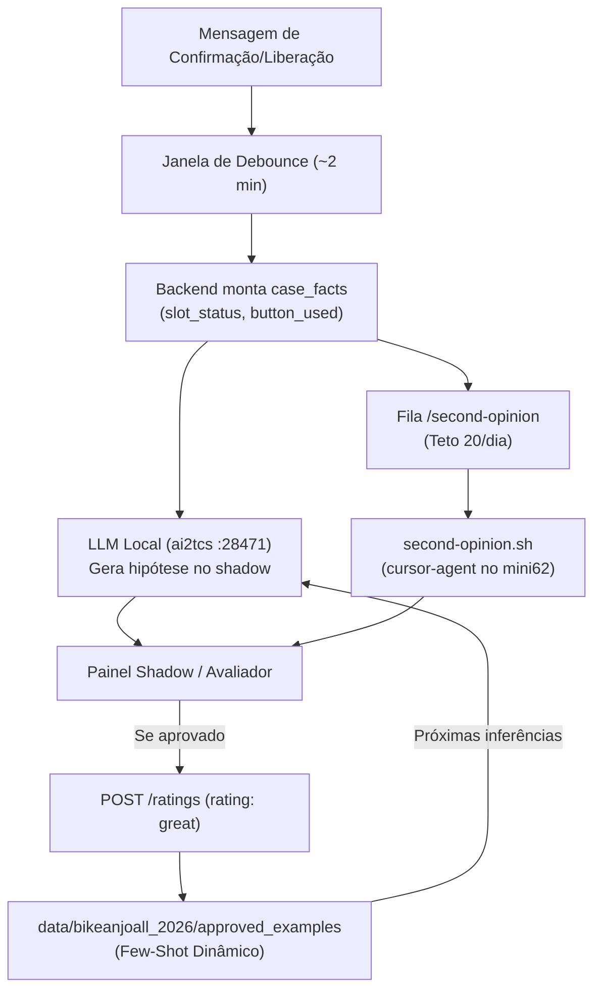

# Guia de Implementação e Isolamento Operacional no mini62

Este documento estabelece as **travas estruturais**, o **wrapper de execução** e a **arquitetura de contingência de recursos** para que agentes maiores (`Cursor Agent` e `Antigravity`) atuem como professores sem colocar em risco o `mini62` nem consumir créditos de forma descontrolada.

---

## 1. Travas e Limites Estruturais de Execução

| Camada | Regra de Isolamento | Mecanismo de Garantia no mini62 |
|---|---|---|
| **1. Permissão de Sistema (OS)** | Usuário sem chave de deploy, sem acesso a `.env` com tokens de produção e sem acesso à Meta Cloud API | Execução sob usuário isolado ou script wrapper com `umask` e paths explícitos de somente leitura |
| **2. Somente Leitura (Zero Mutação)** | O agente professor nunca executa SQL livre, nunca comita código e nunca dispara HTTP mutável | O pacote de entrada já contém os fatos pré-computados (`case_facts`); o wrapper proíbe shell interativo |
| **3. Cota Diária e Budget** | Teto rígido de consultas para não estourar créditos do plano | Contador diário atômico em arquivo (`data/second_opinion_daily.count`); teto padrão: **20 consultas/dia** |
| **4. Timeout e Process Kill** | Impedir que chamadas penduradas prendam a CPU/RAM do Mac mini | Timeout estrito de **45 segundos** com `timeout` / `kill -9` do subprocesso |
| **5. Kill Switch Imediato** | Desligar a fila instantaneamente sem necessidade de redeploy | Flag booleana no banco/config ou existência do arquivo `local-only/DISABLE_SECOND_OPINION` |
| **6. Não-Reutilização de Pontes Largas** | O `zapCursorAgent` (porta `:28472`) é estritamente proibido neste fluxo | Comunicação one-shot via stdin/stdout, sem sessões contínuas e sem canais de chat abertos |

---

## 2. Especificação do Wrapper `second-opinion.sh`

> **Em vigor:** o worker é `llm_api/scripts/second_opinion_worker.py` ([26 § 7](../26-second-opinion.md#7-worker-no-mini62));
> o teto e o interruptor ficam na API. O script abaixo é o rascunho original.

O script `second-opinion.sh` deve viver em `llm_api/scripts/second-opinion.sh` e operar como o único ponto de contato com o `cursor-agent`:

```bash
#!/usr/bin/env bash
# second-opinion.sh — Chamada segura e one-shot ao cursor-agent no mini62
set -euo pipefail

PAYLOAD_FILE="${1:-}"
DAILY_LIMIT="${SECOND_OPINION_DAILY_LIMIT:-20}"
COUNT_FILE="$(cd "$(dirname "$0")/../data" && pwd)/second_opinion_daily.count"
TODAY="$(date +%Y-%m-%d)"
KILL_SWITCH="$(cd "$(dirname "$0")/../../local-only" && pwd)/DISABLE_SECOND_OPINION"

# 1. Kill Switch
if [[ -f "$KILL_SWITCH" ]]; then
  echo '{"error": "second_opinion_disabled_by_kill_switch"}' >&2
  exit 4
fi

# 2. Validação de entrada
if [[ -z "$PAYLOAD_FILE" || ! -f "$PAYLOAD_FILE" ]]; then
  echo '{"error": "payload_file_missing"}' >&2
  exit 2
fi

# 3. Verificação e incremento de cota diária
mkdir -p "$(dirname "$COUNT_FILE")"
LAST_DATE=""
CURRENT_COUNT=0
if [[ -f "$COUNT_FILE" ]]; then
  read -r LAST_DATE CURRENT_COUNT < "$COUNT_FILE" || true
fi

if [[ "$LAST_DATE" != "$TODAY" ]]; then
  CURRENT_COUNT=0
fi

if (( CURRENT_COUNT >= DAILY_LIMIT )); then
  echo '{"error": "daily_limit_reached", "limit": '$DAILY_LIMIT'}' >&2
  exit 3
fi

# 4. Execução protegida (One-Shot com timeout de 45s)
PROMPT_TEMPLATE="Você é um avaliador pedagógico e professor para modelos de linguagem.
Analise o pacote JSON fornecido e retorne ESTRITAMENTE o JSON conforme o schema SecondOpinionResponse.
NÃO use markdown, NÃO adicione explicações fora do JSON.
Pacote de entrada:
$(cat "$PAYLOAD_FILE")"

# Executa cursor-agent em modo prompt único e captura saída
RESPONSE=$(timeout 45s cursor-agent --print --prompt "$PROMPT_TEMPLATE" 2>/dev/null || true)

if [[ -z "$RESPONSE" ]]; then
  echo '{"error": "agent_timeout_or_empty_response"}' >&2
  exit 5
fi

# Incrementa contador diário
echo "$TODAY $((CURRENT_COUNT + 1))" > "$COUNT_FILE"

# Devolve resposta ao chamador
echo "$RESPONSE"
```

---

## 3. O Ciclo de Feedback Pedagógico (`/ratings` $\rightarrow$ LLM Local)

A segunda opinião não é um substituto da LLM: é um **gerador de dados de treino de altíssima qualidade**.



1. **Julgamento:** O professor classifica a hipótese local como `good` ou `bad` e sugere a resposta ideal (`suggested_reply`).
2. **Ingestão no Banco:** Quando uma resposta do professor é consolidada ou revisada pelo operador, ela é enviada para `POST /ratings` com `rating: "great"`.
3. **Few-Shot Dinâmico:** As respostas marcadas como `great` alimentam o retrieval de exemplos aprovados (`retrieval_query_with_history` e `rated_examples`), fazendo com que o `gemma3:12b` local aprenda o padrão e não erre mais em casos análogos.
4. **Métrica de Sucesso:** A taxa de intervenção do professor para o mesmo `intent` cai semana a semana até tender a zero.
