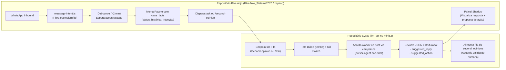
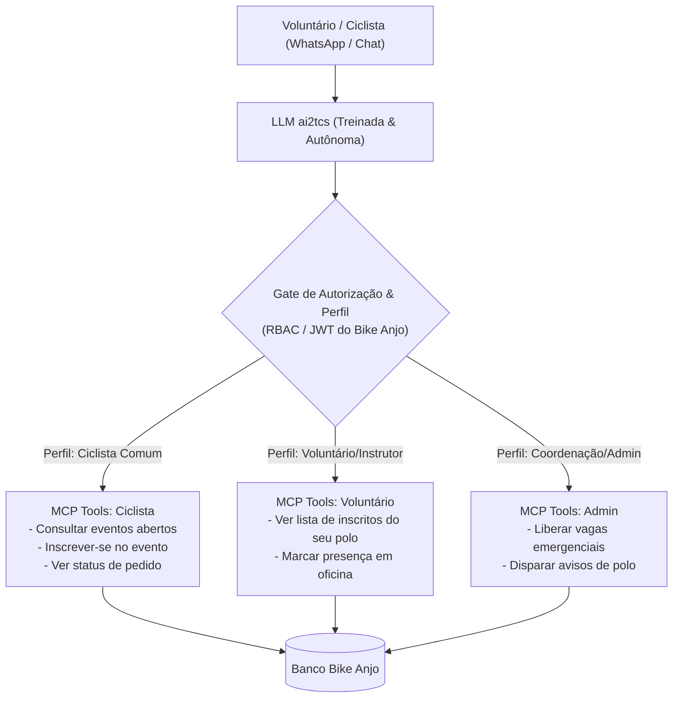

# Onde Mexer: Fronteiras Bike Anjo vs ai2tcs, Roteiro e a Visão MCP

**Data:** 2026-11-12  
**Finalidade:** Delimitar o que mora no repositório do **Bike Anjo** (`BikeAnjo_Sistema2026` / `zapzap`) e o que mora no **ai2tcs** (`llm_api`), amarrando a postura conversacional, o uso seguro do Cursor como mentor e o roadmap de longo prazo para um **MCP com permissões por perfil**.

---

## 1. Postura de Tom e Educação Holística do Agente

O objetivo da segunda opinião com o Cursor não é apenas lidar com confirmação de eventos, mas **educar o agente para compreender profundamente o ecossistema da Bike Anjo e dos sistemas vinculados** (institucional, voluntariado, acolhimento, regras de negócio e triagem):

- **Mineração Histórica do Shadow (Janela de Créditos):** Assim que a cota/janela de créditos for renovada em 5 a 6 dias, o foco inicial será analisar o banco histórico de shadow do `ai2tcs`, categorizando os cenários reais mais recorrentes (dúvidas de iniciantes, relatos de imprevistos, pedidos de rotas, etc.) para alimentar o repertório do agente.
- **Não ser robótico frio:** Em situações humanas reais (ex: Larissa doente), ignorar a dor e responder um texto mecânico de sistema passa sensação de desprezo. Dizer *"Sinto muito, estimo melhoras para ela!"* antes de confirmar a informação humaniza o atendimento com mínimo consumo de tokens.
- **Não virar chatbot de papo furado (Sem conversational maintenance):** O bot **nunca** deve fazer perguntas abertas que convidem à réplica (*"Como posso te ajudar em mais alguma coisa hoje?", "O que ela teve?", "Me conte mais"*). Ele responde o fato, deseja melhoras / dá a informação, e **encerra o turno**.
- **Onde mora a regra:**
  - No `BikeAnjo_Sistema2026`: nos contratos de prompt (`contracts/ai2tcs/prompts/` e `zapzap/flows.js`).
  - No `ai2tcs`: em `config_json.llm_options.tone_of_voice` e na `system_instruction` do projeto `bikeanjoall_2026`.

---

## 2. Como o Cursor é Usado com Segurança Máxima (Zero Ação Indesejada)

Para garantir que o Cursor atue **estritamente como consultor pedagógico/avaliador** e jamais tente rodar comandos, mutações de banco ou disparar mensagens:

1. **Chamada em Modo CLI Fechado (`headless / non-interactive`):**
   - O worker no host (`second_opinion_worker.py`) acorda sob demanda via campainha, passando o histórico na entrada padrão (`stdin`) e exigindo de volta exclusivamente um schema JSON.
2. **Sem Ferramentas / Sem Permissões de Escrita (Zero-Tool Sandbox):**
   - O agente professor não recebe MCPs de escrita, credenciais de banco de dados ou APIs de envio de WhatsApp. Ele não tem "braços" para executar nenhuma ação no sistema.
3. **Proposta de Ação é puramente descritiva (`suggested_action`):**
   - O campo `suggested_action` gerado pelo professor é apenas uma nota textual (ex: `"recomendar_liberar_vaga_manualmente"`). **O sistema não executa essa ação automaticamente.** Ela é enviada apenas para visualização de um operador humano no painel administrativo `/adm/shadow-llm`.

---

## 3. Divisão de Responsabilidades: O que mora no Bike Anjo vs. o que mora no ai2tcs

| Responsabilidade | Repositório | Arquivos Específicos |
|---|---|---|
| **1. Detecção da Campanha & Debounce de ~2 min** | **Bike Anjo** | `zapzap/lib/router-user-context.js`, `zapzap/flows.js` |
| **2. Montagem dos Fatos do Caso (`case_facts`)** | **Bike Anjo** | `zapzap/lib/llm-remote.js` (adiciona contexto do usuário e status da conta) |
| **3. Janela de Proposta de Ação (`suggested_action`)** | **Ambos** | BA consome e exibe no painel shadow; `ai2tcs` padroniza o JSON de saída |
| **4. Fila, Teto Diário (20/dia) e Kill Switch** | **ai2tcs** | `llm_api/app/second_opinion/` (banco de dados) |
| **5. Execução do Professor (`cursor-agent`)** | **ai2tcs** | `llm_api/scripts/second_opinion_worker.py` no `mini62` |
| **6. Aprendizado Contínuo (`/ratings` $\rightarrow$ RAG)** | **ai2tcs** | `llm_api/app/ratings/` e `data/bikeanjoall_2026/` |

---

## 4. Os 10 Primeiros Passos de Código (Roteiro Ordenado)

### Fase 1: Fundação no `ai2tcs` (O Motor do Professor)
- [ ] **Passo 1 (`ai2tcs`):** Manter o receptor leve de campainha no host (`http://127.0.0.1:9191/notify`) que acorda o `second_opinion_worker.py --once` sob demanda exata, mantendo zero consumo de CPU em repouso (compatível com volume de 45-60 msgs/semana).
- [ ] **Passo 2 (`ai2tcs`):** Ativar a rota genérica `POST /second-opinion` no Docker enfileirando o caso com redação de dados sensíveis e disparando a notificação HTTP para `host.docker.internal:9191`.
- [ ] **Passo 3 (`ai2tcs`):** Conectar a avaliação do professor para visualização, mantendo a regra de que aprovação para treino (`/ratings`) depende do aval humano ou de concordância estabelecida.
- [ ] **Passo 4 (`ai2tcs`):** Validar a suíte de testes unitários (`test_second_opinion.py`) garantindo trava de cota diária (20/dia) e os dois interruptores.
- [ ] **Passo 5 (`ai2tcs`):** Espelhar o schema canônico `second-opinion.schema.json` na pasta de contratos (`llm_api/contracts/bikeanjo/`).

### Fase 2: Adaptação no Bike Anjo (O Cliente que Alimenta o Shadow)
- [ ] **Passo 6 (Bike Anjo):** No `zapzap/lib/router-user-context.js`, adicionar a coleta dos fatos da interação no contexto rico (`slot_status`, `button_already_used`, `identity_ok_for_slot`).
- [ ] **Passo 7 (Bike Anjo):** No `zapzap/flows.js`, criar o gatilho de debounce de ~2 min para mensagens recebidas em rajada.
- [ ] **Passo 8 (Bike Anjo):** No cliente HTTP `zapzap/lib/llm-remote.js`, plugar o envio do pacote consolidado para a rota `POST /second-opinion` do `ai2tcs`.

### Fase 3: Proposta de Ação e Ciclo de Avaliação
- [ ] **Passo 9 (Bike Anjo):** Na tela de shadow do Bike Anjo (`/adm/shadow-llm`), exibir a caixinha de **Proposta de Ação** (`suggested_action.type`, `already_applied`, `why`) ao lado da hipótese da LLM local e da resposta do professor.
- [ ] **Passo 10 (Ambos):** Rodar o primeiro fim de semana com cota 30: observar no painel o shadow operando, medir a taxa de concordância entre a LLM local e o Cursor, e recalibrar o portão de corte de "pergunta besta".

---

## 5. O Horizonte Futuro: Evolução para MCP com Permissões por Perfil (~1 Ano)

No estágio maduro da arquitetura, a LLM deixará de ser apenas uma informante passiva e poderá se tornar um **Agente Autônomo com MCP (Model Context Protocol)**:

### Princípios da Fase MCP:
1. **Identidade Estrita do Usuário:** Toda chamada MCP carrega o identificador autenticado do usuário (telefone verificado / sessão vinculada). O agente não pode "assumir" identidades de terceiros.
2. **Escopo Limitado por Perfil:** Um ciclista só pode acionar ferramentas que mexam na sua própria inscrição. Operações administrativas exigem perfil explícito de coordenação.
3. **Auditoria Total de Operações:** Cada mutação executada via tool MCP gera registro de auditoria com timestamp, parâmetros e motivo justificado pelo agente.
